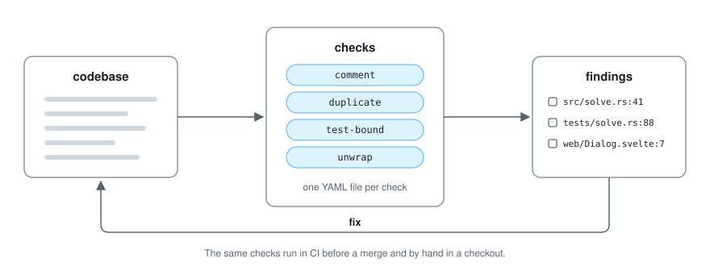

# negentropy

Checks that keep a codebase from decaying while agents and people change it.



```
pipx install git+https://github.com/milanofthe/negentropy
negentropy
```

One command checks the whole codebase and prints what to fix as a checklist. A check is a YAML file
with the message that says what to do: the [built-in ones](src/negentropy/checks), and a
repository's own beside them.

`negentropy.toml` at the root of a repository, every key optional:

```toml
public = ["src/api/**"]
constants = ["**/constants.rs"]
library = ["**/src/**"]
markdown = ["docs/**"]
exempt = ["vendor/**"]
rules = ["tools/checks"]
off = ["attribution"]
characters = "\u00e4\u00f6\u00fc\u00df"

[budget]
constants = 40
features = 3
```

Before a merge: `uses: milanofthe/negentropy@main` after a checkout with `fetch-depth: 0`.
At a commit: `git config --global core.hooksPath <clone>/hooks`.
After an edit of a coding agent: `sh <clone>/hooks/agent` as its hook.

MIT
